# dvm-torch BERT 各类算子链：最新 Device 耗时与具体图结构

更新日期：2026-11-20。版本包含此前的 emit 优化，以及最新的 C05/C10 bool 谓词简化。当前源码和已安装生产扩展的 SHA256 与测量版本一致。

本次重新导出了当前版本的 BS256/512 图结构，并重新汇总了 **bool 优化后的完整训练生产 trace**：每个 batch 使用两张 GPU 的两次独立运行，每次每后端 profile 2 步，共 4 步。链耗时取两次运行均值的算术平均；这里没有重新运行完整训练计时，也没有把新导出图的诊断运行当成性能数据。

**Device 耗时 = GPU kernel + memcpy + memset。**原生 masked_fill 的 clone 拷贝和归约的清零事件已归到对应链。下表统计的是被 DVM 接管的工作，不是整个训练 step，也不是孤立算子链 microbenchmark。

| Batch size | 原生 Device 合计 | DVM Device 合计 | 每步节省 | 耗时下降 |
|---|---:|---:|---:|---:|
| 256 | 245.704 ms | 236.093 ms | 9.611 ms | 3.91% |
| 512 | 485.832 ms | 467.410 ms | 18.422 ms | 3.79% |

每步为 **316 张图、1000 个捕获算子、520 个 DVM kernel、18 类图结构**。其中 88 张是单算子图，228 张是多算子图；单算子图也列入清单，便于评估成图成本。工作负载为 FP32、序列长度 128、hidden size 768、词表 20032、12 层非重入 activation checkpoint，使用原始 Adam 与 NLLLoss，GPU 为 Tesla V100-PCIE-32GB。sum 融合已开启。

## 全部算子链耗时

时间单位为 ms，表示该类图**每个训练 step 的累计耗时**，格式为“原生→DVM（变化）”。变化 = (DVM / 原生 − 1) × 100%，负数更快。Kernel 数为每张图的实际 launch 数；原生 memcpy/memset 另计时间，不计入该列。点击 ID 可跳转到具体图结构。

| ID | 算子链 / 场景 | 图数/步 | Kernel 数：原生→DVM | BS256：ms（变化） | BS512：ms（变化） |
|---|---|---:|---:|---:|---:|
| [C01](#c01) | 位置编码广播相加 | 1 | 1→1 | 0.257→0.365（+41.67%） | 0.508→0.710（+39.84%） |
| [C02](#c02) | 同形状 add | 37 | 1→1 | 13.473→15.809（+17.34%） | 26.809→31.202（+16.38%） |
| [C03](#c03) | 独立 mean(dim=-1) | 12 | 1→2 | 1.546→2.708（+75.18%） | 2.950→5.279（+78.93%） |
| [C04](#c04) | LayerNorm 前向 N5，只保存最终输出 | 24 | 5→1 | 24.616→20.256（-17.71%） | 48.883→41.244（-15.63%） |
| [C05](#c05) | attention 前向：bool 谓词简化 | 12 | 3→1 | 18.457→15.193（-17.68%） | 36.751→30.922（-15.86%） |
| [C06](#c06) | add → mean，有数据依赖 | 24 | 2→2 | 11.896→11.849（-0.40%） | 23.337→23.218（-0.51%） |
| [C07](#c07) | 两个标量 loss 相加 | 1 | 1→1 | 0.0024→0.0068（+177.81%） | 0.0025→0.0072（+187.79%） |
| [C08](#c08) | add 与 mean 两个独立分支 | 1 | 2→3 | 0.495→0.664（+34.33%） | 0.972→1.303（+34.12%） |
| [C09](#c09) | LayerNorm 重计算 N5，保存四个输出 | 24 | 5→1 | 24.621→24.980（+1.46%） | 48.820→49.234（+0.85%） |
| [C10](#c10) | attention 重计算，额外保存 mask | 12 | 3→2 | 18.483→15.507（-16.10%） | 36.745→30.549（-16.86%） |
| [C11](#c11) | LayerNorm 反向 B9，两个归约分支 | 24 | 9→4 | 55.436→44.591（-19.56%） | 109.120→88.052（-19.31%） |
| [C12](#c12) | neg → sum(dim=-1) | 24 | 2→1 | 8.950→6.048（-32.43%） | 17.630→11.786（-33.15%） |
| [C13](#c13) | 梯度 add_ 与 std 反向准备分支 | 24 | 4→2 | 8.903→10.533（+18.31%） | 17.570→20.584（+17.15%） |
| [C14](#c14) | std 反向：masked_fill_、mean 与广播乘法 | 24 | 5→2 | 15.453→23.290（+50.71%） | 30.371→46.110（+51.82%） |
| [C15](#c15) | 单独 add_ 梯度累加 | 37 | 1→1 | 13.480→15.854（+17.61%） | 26.816→31.299（+16.72%） |
| [C16](#c16) | attention 反向：masked_fill → div | 12 | 2→1 | 18.049→15.055（-16.59%） | 35.974→29.842（-17.05%） |
| [C17](#c17) | add_ → sum(dim=(0,1)) | 12 | 2→2 | 6.162→6.245（+1.35%） | 11.900→12.164（+2.23%） |
| [C18](#c18) | add_ 与 mean 两个独立分支 | 11 | 2→3 | 5.424→7.140（+31.62%） | 10.673→13.903（+30.26%） |

主要变化和仍存在的开销：

- C05/C10 现在均比原生快约 16%–18%；两类合计每步节省 6.239 / 12.024 ms（BS256 / BS512）。
- C04/C11/C12 合计每步节省 18.107 / 34.550 ms；attention 三类 C05/C10/C16 合计节省 9.234 / 18.156 ms。
- C14 仍是最大单类劣化来源，每步增加 7.836 / 15.739 ms，约慢 51%–52%。
- 88 张单算子图全部更慢，累计增加 5.985 / 11.411 ms；228 张多算子图合计节省 15.596 / 29.833 ms。
- C06、C09 和 C17 的小幅差异不宜据此判断统计显著性。标量 C07 的百分比大，但绝对耗时仅数微秒。

对应实验的完整训练 step 相对原生变化为 **BS256 +0.03%、BS512 −0.12%**，仍基本持平。它按每张 GPU 的原生/DVM 配对比值取几何平均，不能用上面局部 Device 的 3.8%–3.9% 直接替代。

## 图结构的阅读方式

下图由本次真实 IR 导出，保留以 Store 为根的有效数据依赖、Cast、比较、常量和分支。蓝色是外部输入，绿色是需要保存的图输出；%编号对应链接中 ref graph 的节点编号。仅省略用于创建常量的 LoadDummy，并将 BroadcastS 显示为 Const。lowered graph 还会加入广播/临时存储等节点，详细内容在每类的完整 IR 链接中。

图中 B 同时代表 256 或 512；已验证两组 batch 的归一化节点、依赖、dtype、常量和 live outputs 相同。各类图后列出的 K0/K1… 是**实际 kernel launch 顺序**，不是捕获顺序，也不等同于 lowered graph 的 eager 子图个数。

| 符号 | 实际 shape | 常见用途 |
|---|---|---|
| H | [B,128,768] | hidden / 大张量梯度 |
| R | [B,128,1] | 行均值、标准差及其梯度 |
| V | [768] | gamma / beta |
| G | [1,1,768] | dim=(0,1) 归约输出 |
| A | [B,12,128,128] | attention scores / 梯度 |
| M | [B,1,128,128] | attention bool mask |
| P | [1,128,768] | position embedding |
| S | [] | 0 维标量 |

f32/f16/bool 表示实际 IR dtype。ReduceSum 的维度针对原始张量，均保留维度；Select 的 true/false/cond 边明确表示真值、假值和条件。原地写入用 self0/self1 区分写前和写后，避免画成错误的环。

<a id="c01"></a>

## C01：位置编码广播相加

捕获顺序：`aten::add`。每步 1 张图，原生 1 → DVM 1 个 kernel/图，保存 1 个输出。

BS256：**0.257→0.365（+41.67%） ms**；BS512：**0.508→0.710（+39.84%） ms**（每步累计）。

position 为 P=[1,128,768]，沿 batch 维广播；只有一个逐元素算子。

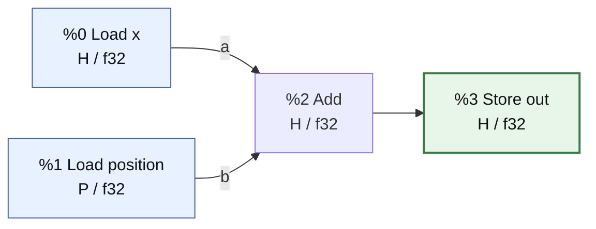

保存输出：`%3 out: H / f32`。

实际 kernel 拆分：

- K0：Add(x, position)，保存 out:H。

完整 ref graph / lowered graph / program：[BS256](../output/benchmarks/bert_chain_inventory_after_emit_2026-11-20/bool_graph_capture/capture_bs256/graphs/graph_948.txt) / [BS512](../output/benchmarks/bert_chain_inventory_after_emit_2026-11-20/bool_graph_capture/capture_bs512/graphs/graph_948.txt)。

<a id="c02"></a>

## C02：同形状 add

捕获顺序：`aten::add`。每步 37 张图，原生 1 → DVM 1 个 kernel/图，保存 1 个输出。

BS256：**13.473→15.809（+17.34%） ms**；BS512：**26.809→31.202（+16.38%） ms**（每步累计）。

两路 H 张量直接相加。

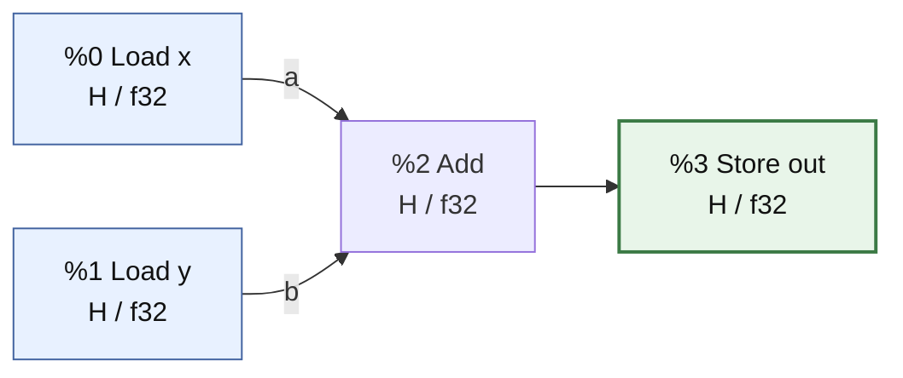

保存输出：`%3 out: H / f32`。

实际 kernel 拆分：

- K0：Add(x, y)，保存 out:H。

完整 ref graph / lowered graph / program：[BS256](../output/benchmarks/bert_chain_inventory_after_emit_2026-11-20/bool_graph_capture/capture_bs256/graphs/graph_949.txt) / [BS512](../output/benchmarks/bert_chain_inventory_after_emit_2026-11-20/bool_graph_capture/capture_bs512/graphs/graph_949.txt)。

<a id="c03"></a>

## C03：独立 mean(dim=-1)

捕获顺序：`aten::mean`。每步 12 张图，原生 1 → DVM 2 个 kernel/图，保存 1 个输出。

BS256：**1.546→2.708（+75.18%） ms**；BS512：**2.950→5.279（+78.93%） ms**（每步累计）。

捕获的是一个 mean，但 emit 将它展开为 ReduceSum 和 Div；实际需要两个 kernel。

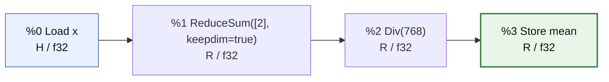

保存输出：`%3 mean: R / f32`。

实际 kernel 拆分：

- K0：ReduceSum(x, dim=2)，写出临时 R。
- K1：读取临时 R，Div(768)，保存 mean:R。

完整 ref graph / lowered graph / program：[BS256](../output/benchmarks/bert_chain_inventory_after_emit_2026-11-20/bool_graph_capture/capture_bs256/graphs/graph_950.txt) / [BS512](../output/benchmarks/bert_chain_inventory_after_emit_2026-11-20/bool_graph_capture/capture_bs512/graphs/graph_950.txt)。

<a id="c04"></a>

## C04：LayerNorm 前向 N5，只保存最终输出

捕获顺序：`aten::sub;aten::mul;aten::add;aten::div;aten::add`。每步 24 张图，原生 5 → DVM 1 个 kernel/图，保存 1 个输出。

BS256：**24.616→20.256（-17.71%） ms**；BS512：**48.883→41.244（-15.63%） ms**（每步累计）。

数据流为 out = gamma * (x - mean_in) / (std_in + 1e-6) + beta。mean_in/std_in 是图外算好的输入，本图不包含 mean/std 归约。

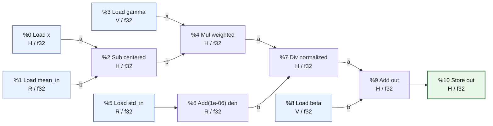

保存输出：`%10 out: H / f32`。

实际 kernel 拆分：

- K0：Sub → Mul；std_in + 1e-6；Div → Add，单个 kernel 只保存 out:H。

完整 ref graph / lowered graph / program：[BS256](../output/benchmarks/bert_chain_inventory_after_emit_2026-11-20/bool_graph_capture/capture_bs256/graphs/graph_951.txt) / [BS512](../output/benchmarks/bert_chain_inventory_after_emit_2026-11-20/bool_graph_capture/capture_bs512/graphs/graph_951.txt)。

<a id="c05"></a>

## C05：attention 前向：bool 谓词简化

捕获顺序：`aten::div;aten::eq;aten::masked_fill`。每步 12 张图，原生 3 → DVM 1 个 kernel/图，保存 1 个输出。

BS256：**18.457→15.193（-17.68%） ms**；BS512：**36.751→30.922（-15.86%） ms**（每步累计）。

等价于 where(keep, scores * 0.125, -1e9)。捕获顺序仍是 div → eq → masked_fill，但 eq 输出已无消费者；ref graph 中的 %3/%4/%5 在后续死节点消除时删除。下图只显示有效节点。bool → FP16 → FP32 的条件转换仍然存在。

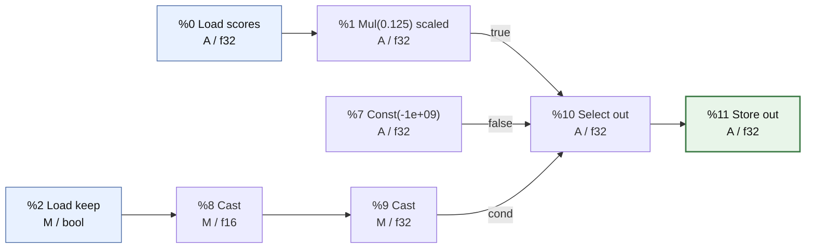

保存输出：`%11 out: A / f32`。

实际 kernel 拆分：

- K0：scores × 0.125；直接转换原始 keep 条件并 Select；保存 out:A。实际程序没有 CompareS。

完整 ref graph / lowered graph / program：[BS256](../output/benchmarks/bert_chain_inventory_after_emit_2026-11-20/bool_graph_capture/capture_bs256/graphs/graph_952.txt) / [BS512](../output/benchmarks/bert_chain_inventory_after_emit_2026-11-20/bool_graph_capture/capture_bs512/graphs/graph_952.txt)。

<a id="c06"></a>

## C06：add → mean，有数据依赖

捕获顺序：`aten::add;aten::mean`。每步 24 张图，原生 2 → DVM 2 个 kernel/图，保存 2 个输出。

BS256：**11.896→11.849（-0.40%） ms**；BS512：**23.337→23.218（-0.51%） ms**（每步累计）。

mean 的输入就是 add 的输出；added:H 本身也必须保留。

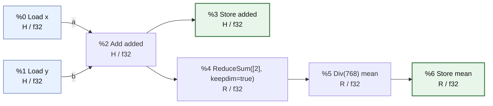

保存输出：`%3 added: H / f32`；`%6 mean: R / f32`。

实际 kernel 拆分：

- K0：计算 added=x+y，保存 added:H；同一 kernel 对 added 做 ReduceSum，写出临时 R。
- K1：读取临时 R，Div(768)，保存 mean:R。

完整 ref graph / lowered graph / program：[BS256](../output/benchmarks/bert_chain_inventory_after_emit_2026-11-20/bool_graph_capture/capture_bs256/graphs/graph_953.txt) / [BS512](../output/benchmarks/bert_chain_inventory_after_emit_2026-11-20/bool_graph_capture/capture_bs512/graphs/graph_953.txt)。

<a id="c07"></a>

## C07：两个标量 loss 相加

捕获顺序：`aten::add`。每步 1 张图，原生 1 → DVM 1 个 kernel/图，保存 1 个输出。

BS256：**0.0024→0.0068（+177.81%） ms**；BS512：**0.0025→0.0072（+187.79%） ms**（每步累计）。

输入和输出都是 0 维标量。相对耗时变化较大，但绝对耗时只有数微秒。

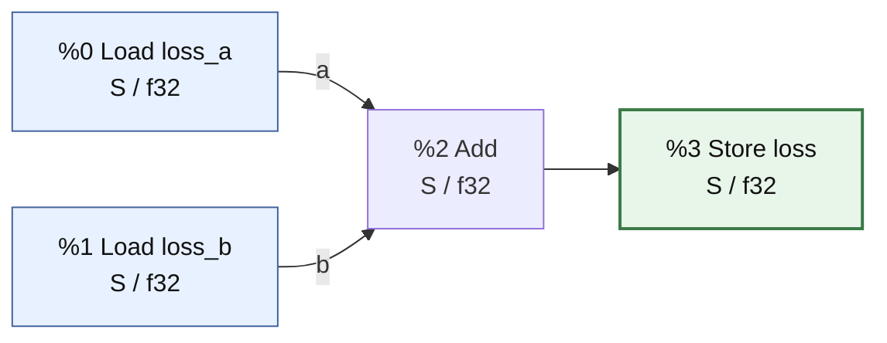

保存输出：`%3 loss: S / f32`。

实际 kernel 拆分：

- K0：标量 Add，保存 loss:S。

完整 ref graph / lowered graph / program：[BS256](../output/benchmarks/bert_chain_inventory_after_emit_2026-11-20/bool_graph_capture/capture_bs256/graphs/graph_1022.txt) / [BS512](../output/benchmarks/bert_chain_inventory_after_emit_2026-11-20/bool_graph_capture/capture_bs512/graphs/graph_1022.txt)。

<a id="c08"></a>

## C08：add 与 mean 两个独立分支

捕获顺序：`aten::add;aten::mean`。每步 1 张图，原生 2 → DVM 3 个 kernel/图，保存 2 个输出。

BS256：**0.495→0.664（+34.33%） ms**；BS512：**0.972→1.303（+34.12%） ms**（每步累计）。

z 是独立输入，add 没有连到 mean。它们被捕获在同一张图里，实际拆成三个 kernel；不能画成 add → mean。

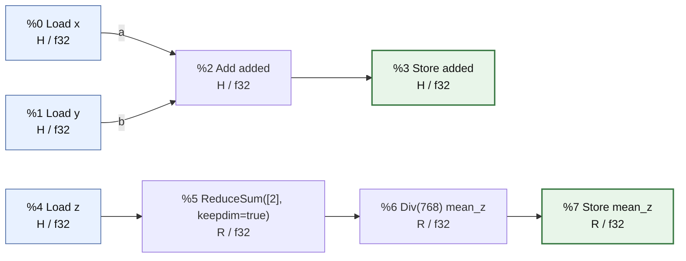

保存输出：`%3 added: H / f32`；`%7 mean_z: R / f32`。

实际 kernel 拆分：

- K0：ReduceSum(z, dim=2)，写出临时 R。
- K1：Div(768)，保存 mean_z:R。
- K2：独立计算 x+y，保存 added:H。

完整 ref graph / lowered graph / program：[BS256](../output/benchmarks/bert_chain_inventory_after_emit_2026-11-20/bool_graph_capture/capture_bs256/graphs/graph_1023.txt) / [BS512](../output/benchmarks/bert_chain_inventory_after_emit_2026-11-20/bool_graph_capture/capture_bs512/graphs/graph_1023.txt)。

<a id="c09"></a>

## C09：LayerNorm 重计算 N5，保存四个输出

捕获顺序：`aten::sub;aten::mul;aten::add;aten::div;aten::add`。每步 24 张图，原生 5 → DVM 1 个 kernel/图，保存 4 个输出。

BS256：**24.621→24.980（+1.46%） ms**；BS512：**48.820→49.234（+0.85%） ms**（每步累计）。

算术表达式与 C04 相同；checkpoint 重计算时，反向还要用到三个中间结果，所以不能只写最终输出。

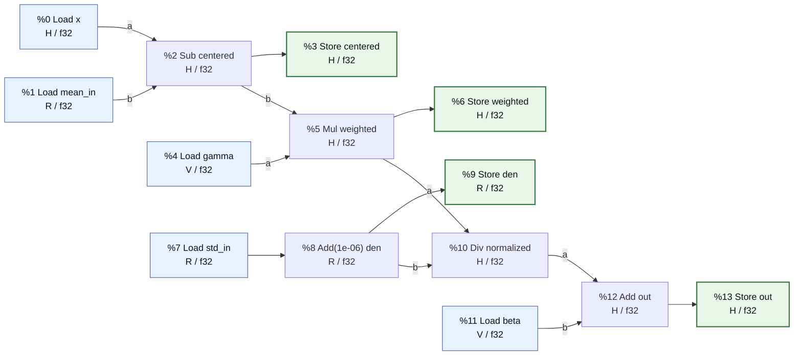

保存输出：`%3 centered: H / f32`；`%6 weighted: H / f32`；`%9 den: R / f32`；`%13 out: H / f32`。

实际 kernel 拆分：

- K0：单个 kernel 计算 N5，同时保存 centered:H、weighted:H、den:R、out:H。

完整 ref graph / lowered graph / program：[BS256](../output/benchmarks/bert_chain_inventory_after_emit_2026-11-20/bool_graph_capture/capture_bs256/graphs/graph_1024.txt) / [BS512](../output/benchmarks/bert_chain_inventory_after_emit_2026-11-20/bool_graph_capture/capture_bs512/graphs/graph_1024.txt)。

<a id="c10"></a>

## C10：attention 重计算，额外保存 mask

捕获顺序：`aten::div;aten::eq;aten::masked_fill`。每步 12 张图，原生 3 → DVM 2 个 kernel/图，保存 2 个输出。

BS256：**18.483→15.507（-16.10%） ms**；BS512：**36.745→30.549（-16.86%） ms**（每步累计）。

主分支等价于 where(keep, scores * 0.125, -1e9)；独立分支保存 saved_mask = (keep == 0)，供后续反向使用。saved_mask 不再回流到本图的 Select，但比较与输出存储仍必须执行。

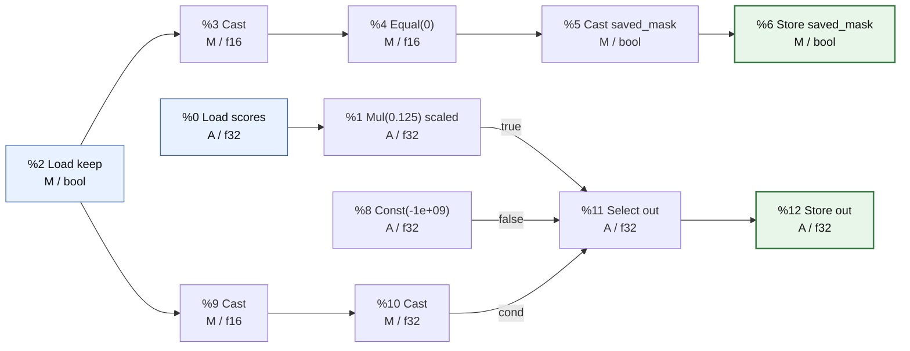

保存输出：`%6 saved_mask: M / bool`；`%12 out: A / f32`。

实际 kernel 拆分：

- K0：scores × 0.125；直接用原始 keep 条件 Select，保存 out:A。
- K1：计算 keep == 0，转换为 bool，保存 saved_mask:M。

完整 ref graph / lowered graph / program：[BS256](../output/benchmarks/bert_chain_inventory_after_emit_2026-11-20/bool_graph_capture/capture_bs256/graphs/graph_1025.txt) / [BS512](../output/benchmarks/bert_chain_inventory_after_emit_2026-11-20/bool_graph_capture/capture_bs512/graphs/graph_1025.txt)。

<a id="c11"></a>

## C11：LayerNorm 反向 B9，两个归约分支

捕获顺序：`aten::div;aten::div;aten::neg;aten::mul;aten::div;aten::sum;aten::mul;aten::mul;aten::sum`。每步 24 张图，原生 9 → DVM 4 个 kernel/图，保存 4 个输出。

BS256：**55.436→44.591（-19.56%） ms**；BS512：**109.120→88.052（-19.31%） ms**（每步累计）。

u 是前向保存的 weighted，g 是上游梯度。两个连续 Div 仍保留；neg 已直接 emit 为 Mul(-1)。图内有沿末维和沿前两维的两种 sum，不能将 9 个算子画成一条直线。

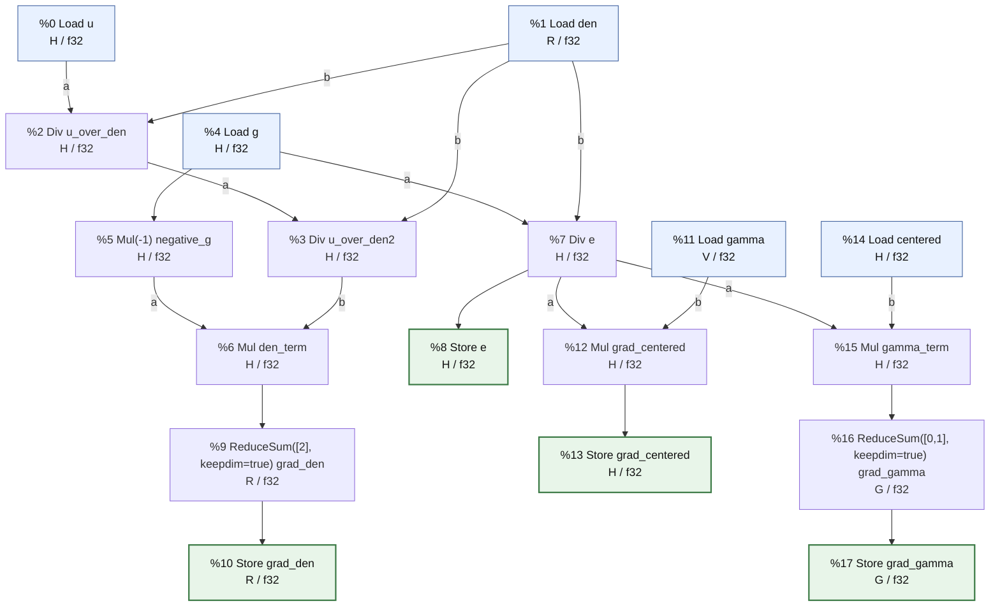

保存输出：`%8 e: H / f32`；`%10 grad_den: R / f32`；`%13 grad_centered: H / f32`；`%17 grad_gamma: G / f32`。

实际 kernel 拆分：

- K0：将 grad_gamma:G 的累加缓冲区清零；这是 DVM kernel。
- K1：e=g/den，保存 e:H；计算 e*centered，并沿 dim=(0,1) 归约，以 atomic store 累加 grad_gamma:G。
- K2：读取 e:H，与 gamma:V 相乘，保存 grad_centered:H。
- K3：计算 (-g)*(u/den/den)，沿 dim=2 归约，保存 grad_den:R。

完整 ref graph / lowered graph / program：[BS256](../output/benchmarks/bert_chain_inventory_after_emit_2026-11-20/bool_graph_capture/capture_bs256/graphs/graph_1029.txt) / [BS512](../output/benchmarks/bert_chain_inventory_after_emit_2026-11-20/bool_graph_capture/capture_bs512/graphs/graph_1029.txt)。

<a id="c12"></a>

## C12：neg → sum(dim=-1)

捕获顺序：`aten::neg;aten::sum`。每步 24 张图，原生 2 → DVM 1 个 kernel/图，保存 1 个输出。

BS256：**8.950→6.048（-32.43%） ms**；BS512：**17.630→11.786（-33.15%） ms**（每步累计）。

neg 已经是直接 Mul(-1)，没有旧实现中的 Add(0)。

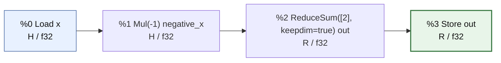

保存输出：`%3 out: R / f32`。

实际 kernel 拆分：

- K0：Mul(-1) 与 ReduceSum(dim=2) 合在一个 kernel，保存 out:R。

完整 ref graph / lowered graph / program：[BS256](../output/benchmarks/bert_chain_inventory_after_emit_2026-11-20/bool_graph_capture/capture_bs256/graphs/graph_1030.txt) / [BS512](../output/benchmarks/bert_chain_inventory_after_emit_2026-11-20/bool_graph_capture/capture_bs512/graphs/graph_1030.txt)。

<a id="c13"></a>

## C13：梯度 add_ 与 std 反向准备分支

捕获顺序：`aten::add_!;aten::mul;aten::div;aten::eq`。每步 24 张图，原生 4 → DVM 2 个 kernel/图，保存 4 个输出。

BS256：**8.903→10.533（+18.31%） ms**；BS512：**17.570→20.584（+17.15%） ms**（每步累计）。

大张量梯度累加与小张量分支没有数据依赖。这里 eq 的输入 std 是 FP32，不属于本次 bool 谓词改写；比较和 Cast 链保留。

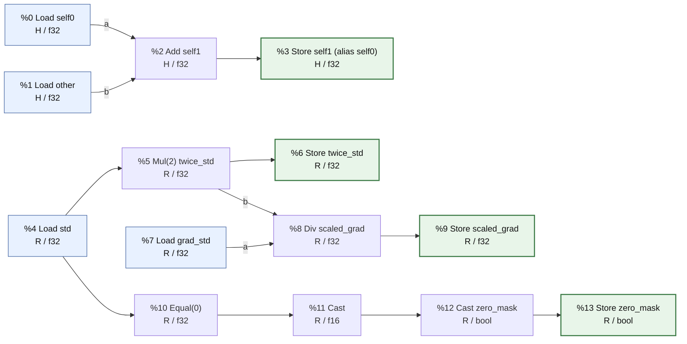

保存输出：`%3 self1 (alias self0): H / f32`；`%6 twice_std: R / f32`；`%9 scaled_grad: R / f32`；`%13 zero_mask: R / bool`。

实际 kernel 拆分：

- K0：小张量 R 分支：std==0；twice_std=std*2；scaled_grad=grad_std/twice_std；保存三个输出。
- K1：独立大张量 H 分支：self1=self0+other，写回 self0 的存储。

完整 ref graph / lowered graph / program：[BS256](../output/benchmarks/bert_chain_inventory_after_emit_2026-11-20/bool_graph_capture/capture_bs256/graphs/graph_1031.txt) / [BS512](../output/benchmarks/bert_chain_inventory_after_emit_2026-11-20/bool_graph_capture/capture_bs512/graphs/graph_1031.txt)。

<a id="c14"></a>

## C14：std 反向：masked_fill_、mean 与广播乘法

捕获顺序：`aten::masked_fill_!;aten::mean;aten::sub;aten::mul;aten::mul`。每步 24 张图，原生 5 → DVM 2 个 kernel/图，保存 1 个输出。

BS256：**15.453→23.290（+50.71%） ms**；BS512：**30.371→46.110（+51.82%） ms**（每步累计）。

等价于 out = where(zero_mask, 0, scaled_grad) * (2/767) * (x - mean(x,-1))。Mul 常量在文本 IR 中打印为 0.00260756。masked_fill_ 的小张量结果没有独立 Store；只有最终 H 输出存活。当前实现仍由 DVM 执行 mean。

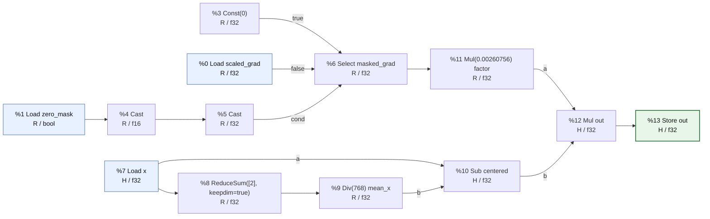

保存输出：`%13 out: H / f32`。

实际 kernel 拆分：

- K0：ReduceSum(x, dim=2)，写出临时 R。
- K1：zero_mask 选择 0 或 scaled_grad；乘 2/767；读取临时 R 并 Div(768)；x 减均值，再乘广播系数，保存 out:H。

完整 ref graph / lowered graph / program：[BS256](../output/benchmarks/bert_chain_inventory_after_emit_2026-11-20/bool_graph_capture/capture_bs256/graphs/graph_1032.txt) / [BS512](../output/benchmarks/bert_chain_inventory_after_emit_2026-11-20/bool_graph_capture/capture_bs512/graphs/graph_1032.txt)。

<a id="c15"></a>

## C15：单独 add_ 梯度累加

捕获顺序：`aten::add_!`。每步 37 张图，原生 1 → DVM 1 个 kernel/图，保存 1 个输出。

BS256：**13.480→15.854（+17.61%） ms**；BS512：**26.816→31.299（+16.72%） ms**（每步累计）。

与 C02 算术相同，但具有原地写入语义。图中用 self0/self1 表示写前、写后的值。

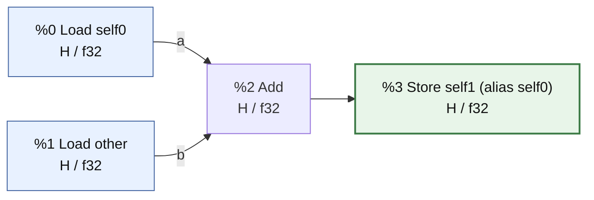

保存输出：`%3 self1 (alias self0): H / f32`。

实际 kernel 拆分：

- K0：self1=self0+other，写回 self0 的存储。

完整 ref graph / lowered graph / program：[BS256](../output/benchmarks/bert_chain_inventory_after_emit_2026-11-20/bool_graph_capture/capture_bs256/graphs/graph_1033.txt) / [BS512](../output/benchmarks/bert_chain_inventory_after_emit_2026-11-20/bool_graph_capture/capture_bs512/graphs/graph_1033.txt)。

<a id="c16"></a>

## C16：attention 反向：masked_fill → div

捕获顺序：`aten::masked_fill;aten::div`。每步 12 张图，原生 2 → DVM 1 个 kernel/图，保存 1 个输出。

BS256：**18.049→15.055（-16.59%） ms**；BS512：**35.974→29.842（-17.05%） ms**（每步累计）。

等价于 where(saved_mask, 0, grad) * 0.125。mask 是已经物化的图输入，本图没有 eq 节点，也不跨图追溯它的来源。

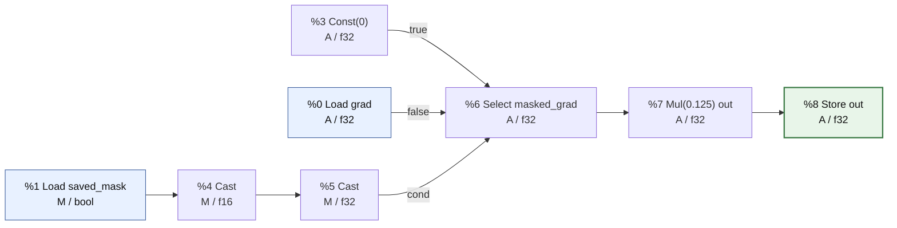

保存输出：`%8 out: A / f32`。

实际 kernel 拆分：

- K0：Select(saved_mask, 0, grad)，随后乘 0.125，保存 out:A。

完整 ref graph / lowered graph / program：[BS256](../output/benchmarks/bert_chain_inventory_after_emit_2026-11-20/bool_graph_capture/capture_bs256/graphs/graph_1035.txt) / [BS512](../output/benchmarks/bert_chain_inventory_after_emit_2026-11-20/bool_graph_capture/capture_bs512/graphs/graph_1035.txt)。

<a id="c17"></a>

## C17：add_ → sum(dim=(0,1))

捕获顺序：`aten::add_!;aten::sum`。每步 12 张图，原生 2 → DVM 2 个 kernel/图，保存 2 个输出。

BS256：**6.162→6.245（+1.35%） ms**；BS512：**11.900→12.164（+2.23%） ms**（每步累计）。

sum 依赖 add_ 的结果。lowered graph 只有一个 eager 子图，但程序包含清零和计算两次 kernel launch。

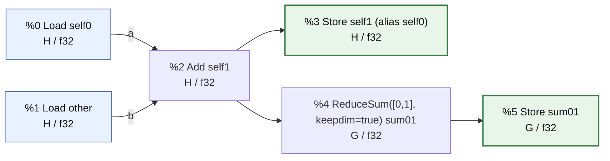

保存输出：`%3 self1 (alias self0): H / f32`；`%5 sum01: G / f32`。

实际 kernel 拆分：

- K0：将 sum01:G 的累加缓冲区清零；这是 DVM kernel。
- K1：计算 self1=self0+other 并写回，同时沿 dim=(0,1) 归约，通过 atomic store 累加 sum01:G。

完整 ref graph / lowered graph / program：[BS256](../output/benchmarks/bert_chain_inventory_after_emit_2026-11-20/bool_graph_capture/capture_bs256/graphs/graph_1037.txt) / [BS512](../output/benchmarks/bert_chain_inventory_after_emit_2026-11-20/bool_graph_capture/capture_bs512/graphs/graph_1037.txt)。

<a id="c18"></a>

## C18：add_ 与 mean 两个独立分支

捕获顺序：`aten::add_!;aten::mean`。每步 11 张图，原生 2 → DVM 3 个 kernel/图，保存 2 个输出。

BS256：**5.424→7.140（+31.62%） ms**；BS512：**10.673→13.903（+30.26%） ms**（每步累计）。

与 C08 一样，mean 读取独立输入 z；区别是 add_ 写回已有张量。实际为三个 kernel，不能画成 add_ → mean。

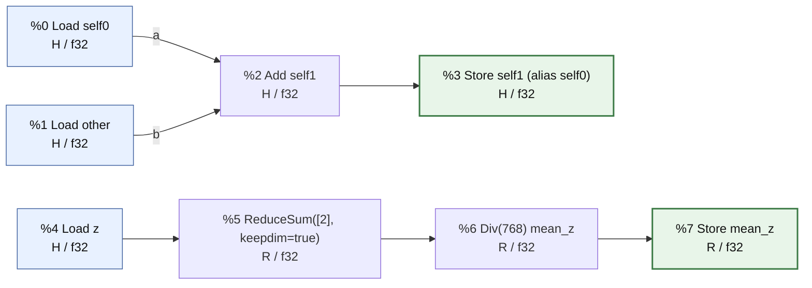

保存输出：`%3 self1 (alias self0): H / f32`；`%7 mean_z: R / f32`。

实际 kernel 拆分：

- K0：ReduceSum(z, dim=2)，写出临时 R。
- K1：Div(768)，保存 mean_z:R。
- K2：独立计算 self1=self0+other，并写回 self0 的存储。

完整 ref graph / lowered graph / program：[BS256](../output/benchmarks/bert_chain_inventory_after_emit_2026-11-20/bool_graph_capture/capture_bs256/graphs/graph_1043.txt) / [BS512](../output/benchmarks/bert_chain_inventory_after_emit_2026-11-20/bool_graph_capture/capture_bs512/graphs/graph_1043.txt)。

## 数据来源与校验

性能来自 `bool_predicate_2026-11-20/train_bs256_gpu{0,1}_after` 和 `train_bs512_gpu{4,5}_after` 的生产 trace。新诊断扩展只在隔离目录中构建，用于记录图标签和 IR；没有替换已安装的生产扩展。

每个 batch 的 4 步共核对 **1264 张图、4000 个被替换原生 kernel、2080 个 DVM kernel、288 个原生内存事件**，每个事件只归属一次。原生每步 36 个 memcpy 和 36 个 memset 已计入链耗时；DVM 图内清零 kernel 已计入 DVM 耗时。其余 GPU 工作逐条匹配，链内与链外时间之和同完整 trace 对账；事件时长之和与区间并集之差小于 0.001 ms/step。

新导出的每组 316 张图均与生产 trace 按捕获算子身份、kernel 顺序、名称、grid/block、shared memory、寄存器数及 CPU caller 核对。C05 的死比较分支未出现在 lowered program；C10 的保存 mask 分支仍存在。导图后的源码与生产扩展 hash 再次核对一致。

本次是对最新已有性能数据的更新和新图结构的导出。没有增加独立性能重复次数；GPU 频率和运行波动仍会影响微小差异。本清单不把小于 1% 的差异视为确定收益。

生产扩展 SHA256：`2d904b93c84acc020660da4eb64b4d028651c8034eacb4077eabf7022c07f4ac`。

DVM runtime SHA256：`7d913496bd142bc847a32e76ca635e20138953cd26db6d501e65ecd1d800cb4f`。

- [全部算子链 CSV](../output/benchmarks/bert_chain_inventory_after_emit_2026-11-20/all_chains.csv)：18 行，保留 BS256/512 的逐步、单次及原生 kernel/copy/set 分项；新增有效 IR 数据流、保存输出、kernel 拆分和图文件路径。
- [bool 优化实验 CSV](../output/benchmarks/bool_predicate_2026-11-20/all_chains.csv)：保留 36 行前后对比格式，追加相同的当前图结构信息。
- [图结构 JSON](../output/benchmarks/bert_chain_inventory_after_emit_2026-11-20/graph_structures.json)：节点、边、Mermaid 和两组 batch 的原始 IR 路径。
- [统计与验证 JSON](../output/benchmarks/bert_chain_inventory_after_emit_2026-11-20/summary.json) / [新导图匹配结果](../output/benchmarks/bert_chain_inventory_after_emit_2026-11-20/current_graphs.json)。
- [BS256 逐图归属](../output/benchmarks/bert_chain_inventory_after_emit_2026-11-20/attribution_bs256.json) / [BS512 逐图归属](../output/benchmarks/bert_chain_inventory_after_emit_2026-11-20/attribution_bs512.json)：每条记录带来源运行，避免不同运行的 graph ID 混淆。
- [bool 谓词优化实验报告](../output/benchmarks/bool_predicate_2026-11-20/report.md)：包含优化前后与完整训练的配对结果。
- [本次更新前的报告备份](../output/benchmarks/bert_chain_inventory_after_emit_2026-11-20/before_bool_predicate/dvm_torch_bert_fusion_chain_performance_after_emit_2026-11-20.md) / [此前 emit 优化前基线](dvm_torch_bert_fusion_chain_performance_2026-11-20.md)。

在仓库根目录重新生成统计和文档：

```bash
python output/benchmarks/bert_chain_inventory_after_emit_2026-11-20/verify_current_graphs.py
python output/benchmarks/bert_chain_inventory_after_emit_2026-11-20/refresh_attribution.py
python output/benchmarks/bert_chain_inventory_after_emit_2026-11-20/write_report.py
```

命令复用已保存的生产 trace 和新诊断图，不重新训练。CSV 中图文件路径以仓库根目录为基准。
